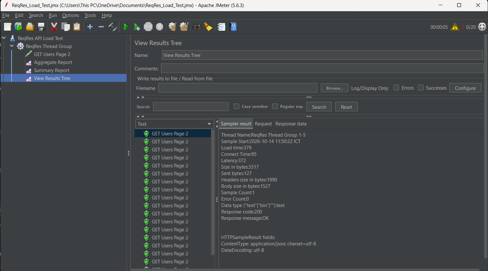
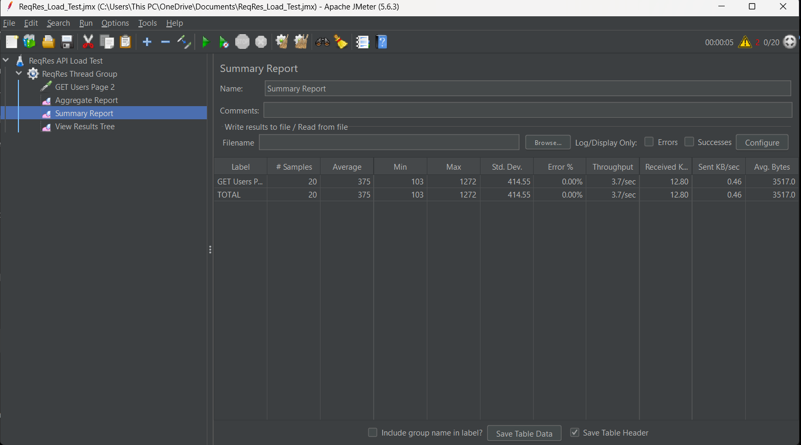

# Lab 8 – Kiểm thử hiệu năng API bằng Apache JMeter
Họ và Tên: Lữ Trung Anh 
Mã Sinh Viên: 23010339
## 1. Giới thiệu

Bài thực hành Lab 8 tìm hiểu và sử dụng công cụ **Apache JMeter** để kiểm thử hiệu năng (Performance Testing) của một API. Thông qua bài thực hành, tiến hành gửi nhiều HTTP request đến API, thu thập thời gian phản hồi và đánh giá kết quả dựa trên các chỉ số thống kê.

## 2. Mục tiêu

- Làm quen với giao diện và cách sử dụng Apache JMeter.
- Tạo kịch bản kiểm thử API bằng HTTP Request.
- Thiết lập số lượng người dùng ảo và thời gian khởi chạy.
- Theo dõi kết quả của từng request.
- Phân tích báo cáo hiệu năng thông qua Summary Report.
- Lưu kết quả kiểm thử và hình ảnh minh họa vào GitHub repository.

## 3. Công cụ và môi trường

| Thành phần | Thông tin |
|---|---|
| Công cụ kiểm thử | Apache JMeter 5.6.3 |
| Ngôn ngữ / giao thức | HTTP/HTTPS |
| API kiểm thử | ReqRes API |
| Phương thức request | GET |
| Endpoint | `https://reqres.in/api/users?page=2` |
| Hệ điều hành | Windows |
| Java | OpenJDK 22.0.2 |

## 4. Cấu hình kiểm thử

Kịch bản kiểm thử được thiết lập trong Apache JMeter như sau:

| Tham số | Giá trị |
|---|---:|
| Number of Threads (users) | 20 |
| Ramp-up Period | 5 giây |
| Loop Count | 1 |
| HTTP Method | GET |
| Request Path | `/api/users?page=2` |

**Giải thích cấu hình:**

- **Number of Threads:** Tạo 20 người dùng ảo để gửi request.
- **Ramp-up Period:** Phân bổ thời gian khởi chạy 20 người dùng trong 5 giây.
- **Loop Count:** Mỗi người dùng thực hiện kịch bản một lần.
- **HTTP Request:** Gửi yêu cầu GET để lấy danh sách người dùng từ API.

Với cấu hình trên, kịch bản dự kiến tạo 20 request nếu tất cả người dùng chạy hoàn tất.

## 5. Các bước thực hiện

### Bước 1: Kiểm tra API

Truy cập endpoint:

`https://reqres.in/api/users?page=2`

API trả về dữ liệu JSON chứa thông tin người dùng như ID, email, họ tên và URL ảnh đại diện.

### Bước 2: Tạo Test Plan

Tạo Test Plan trong Apache JMeter với tên `ReqRes API Load Test`.

### Bước 3: Thêm Thread Group

Thêm Thread Group vào Test Plan và thiết lập:
- Number of Threads: 20.
- Ramp-up Period: 5 giây.
- Loop Count: 1.

### Bước 4: Cấu hình HTTP Request

Thêm HTTP Request vào Thread Group với các thông số:
- Protocol: `https`.
- Server Name or IP: `reqres.in`.
- Method: `GET`.
- Path: `/api/users?page=2`.

### Bước 5: Thêm Listener

Thêm các Listener để theo dõi và tổng hợp kết quả:
- **View Results Tree:** Xem chi tiết từng request và response.
- **Summary Report:** Tổng hợp các chỉ số hiệu năng.
- **Aggregate Report:** Xem các số liệu thống kê tổng hợp.

### Bước 6: Chạy kiểm thử

Lưu Test Plan dưới dạng file `.jmx`, sau đó nhấn Start để chạy kịch bản. Sau khi hoàn tất, kiểm tra kết quả tại View Results Tree và Summary Report.

## 6. Kết quả kiểm thử

Kết quả thu được từ Summary Report của Apache JMeter:

| Chỉ số | Kết quả |
|---|---:|
| Tổng số request (Samples) | 20 |
| Thời gian phản hồi trung bình (Average) | 375 ms |
| Thời gian phản hồi nhỏ nhất (Min) | 103 ms |
| Thời gian phản hồi lớn nhất (Max) | 1272 ms |
| Độ lệch chuẩn (Standard Deviation) | 414.55 ms |
| Tỷ lệ lỗi (Error %) | 0.00% |
| Thông lượng (Throughput) | 3.7 requests/second |

### Giải thích kết quả

- **Samples = 20:** Có 20 request được ghi nhận trong báo cáo.
- **Average = 375 ms:** Thời gian phản hồi trung bình của các request là 375 mili giây.
- **Min = 103 ms:** Request nhanh nhất có thời gian phản hồi 103 mili giây.
- **Max = 1272 ms:** Request chậm nhất có thời gian phản hồi 1272 mili giây.
- **Standard Deviation = 414.55 ms:** Thời gian phản hồi có mức dao động tương đối lớn.
- **Error = 0.00%:** Không ghi nhận request lỗi trong lần chạy này.
- **Throughput = 3.7 requests/second:** Hệ thống xử lý trung bình khoảng 3,7 request mỗi giây trong lần kiểm thử.

## 7. Hình ảnh minh họa

Lưu ảnh chụp màn hình vào thư mục `screenshots/` trong repository.

### 7.1. Kết quả của một HTTP Request

Ảnh minh họa cần thể hiện:
- Tên request `GET Users Page 2`.
- Response Code: `200`.
- Response Message: `OK`.
- Error Count: `0`.

### 7.2. Báo cáo Summary Report

Ảnh minh họa cần thể hiện tổng số request, thời gian phản hồi trung bình, thời gian nhỏ nhất/lớn nhất và tỷ lệ lỗi.

**Lưu ý:** Hai ảnh trên cần được chụp từ kết quả chạy thực tế trong JMeter và tải lên đúng thư mục `screenshots/`. Tên file ảnh trong repository phải trùng với tên được tham chiếu trong README.

## 8. Nhận xét và đánh giá

Qua quá trình kiểm thử, Apache JMeter đã gửi thành công 20 request đến endpoint lấy danh sách người dùng của ReqRes API. Kết quả Summary Report ghi nhận tỷ lệ lỗi là 0.00%, thời gian phản hồi trung bình là 375 ms.

Tuy nhiên, thời gian phản hồi dao động từ 103 ms đến 1272 ms, cho thấy độ ổn định về thời gian phản hồi chưa đồng đều trong lần chạy này. Thông lượng đạt khoảng 3,7 request/giây.

Do quy mô kiểm thử chỉ gồm 20 người dùng ảo và một vòng lặp, kết quả chỉ phản ánh lần kiểm thử với cấu hình đã thiết lập. Chưa đủ cơ sở để kết luận về khả năng chịu tải tối đa của API. Ngoài ra, kết quả có thể chịu ảnh hưởng bởi kết nối mạng, độ trễ của máy chủ và giới hạn của dịch vụ API bên ngoài.

## 9. Kết luận

Bài thực hành giúp làm quen với Apache JMeter, xây dựng kịch bản kiểm thử HTTP Request và đọc các chỉ số hiệu năng cơ bản. Thông qua View Results Tree và Summary Report, có thể kiểm tra phản hồi của API, thống kê thời gian xử lý và đánh giá tỷ lệ lỗi.

Trong các lần kiểm thử tiếp theo, có thể tăng số lượng người dùng ảo, thay đổi thời gian Ramp-up và thực hiện nhiều lần chạy để so sánh kết quả. Khi kiểm thử tải lớn, cần tuân thủ giới hạn sử dụng của dịch vụ API.

## 10. Tài liệu tham khảo

- Apache JMeter: https://jmeter.apache.org/
- ReqRes API: https://reqres.in/
- Apache JMeter User Manual: https://jmeter.apache.org/usermanual/
